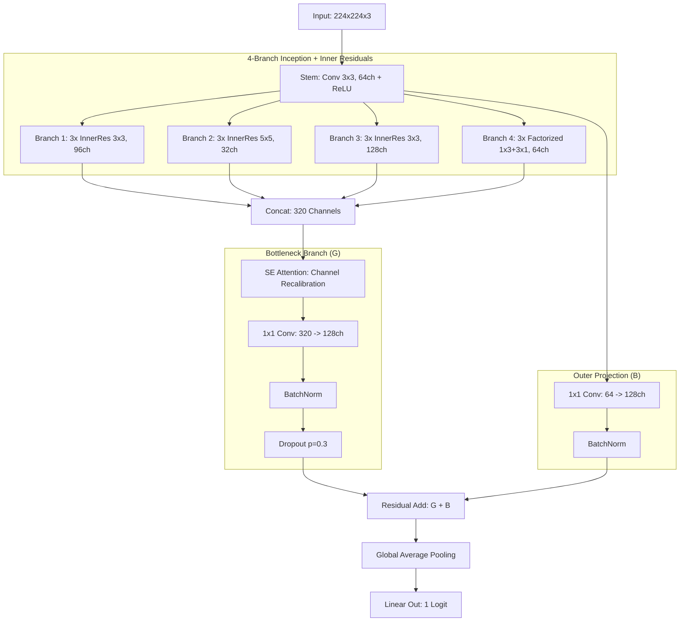
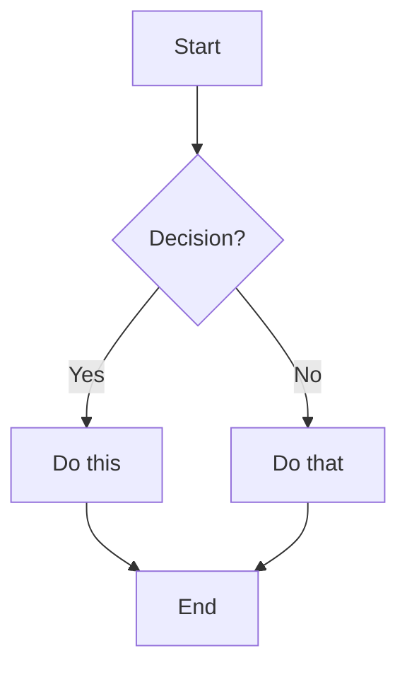

Imbalance Data : (Aya Paper)
Split	Size	Normal	Pneumonia 
Training   	4684	 1736	 2948
Testing	    1172	  317	  855

- Is kfolds needed? 

- Different Loss Function

- mixed precision training

pneumonia_04.ipynb.
Resolution (128x128): Gives the model more spatial evidence to distinguish subtle edge cases.
Regularization (DropPath/Label Smoothing): Prevents the model from "memorizing" the training set, forcing it to find more generalized features.
Class-Weighted Loss: Encourages the model to naturally prioritize Precision during the learning phase, rather than just shifting a boundary afterward.

pneumonia_05.ipynb.

SauberModel5
 introduces several critical architectural and training improvements over SauberModel4 to cross the >95% accuracy threshold:

1. Resolution Upgrade (128x128 → 224x224)
Improvement: The input pipeline was overhauled to handle higher resolution.
Rationale: Lung textures (like interstitial opacities) are often very fine-grained. At 128x128, subtle evidence can be lost; 224x224 provides the model with enough spatial "real estate" to distinguish between true pneumonia and similar-looking noise.
2. Squeeze-and-Excitation (SE) Attention
Improvement: An SE layer was integrated at the 4-branch bottleneck (320 channels).
Rationale: Not all features are equally useful. SE recalibrates the importance of each channel by "squeezing" spatial info and "exciting" relevant features, effectively helping the model focus on the most diagnostic patterns.
3. Projection Statistical Alignment (The "Batch Normalization" fix)
Improvement: Added BatchNorm2d to all residual shortcut branches (Projection_A and Projection_B).
Rationale: As you noted, adding a "clean" branch to a "normalized" branch causes a statistical mismatch. By normalizing both paths before the residual addition, we eliminate Internal Covariate Shift, leading to more stable and faster convergence.
4. OneCycleLR Learning Policy
Improvement: Switched from a fixed learning rate to a dynamic OneCycleLR schedule.
Rationale: This policy starts low, ramps up to 1e-3 (LR Warmup) to cross difficult loss plateaus, and then decays slowly. It acts as a form of regularization that helps the model find flatter, more generalizable minima.
5. Wider Global Feature Path
Improvement: The final 1x1 bottleneck width was increased to 128 channels (up from earlier smaller variants).
Rationale: This ensures that the richer features captured by the Attention layer aren't lost through an overly aggressive "bottleneck," providing a better vector to the Global Average Pooling layer.

- Test Mermaid
